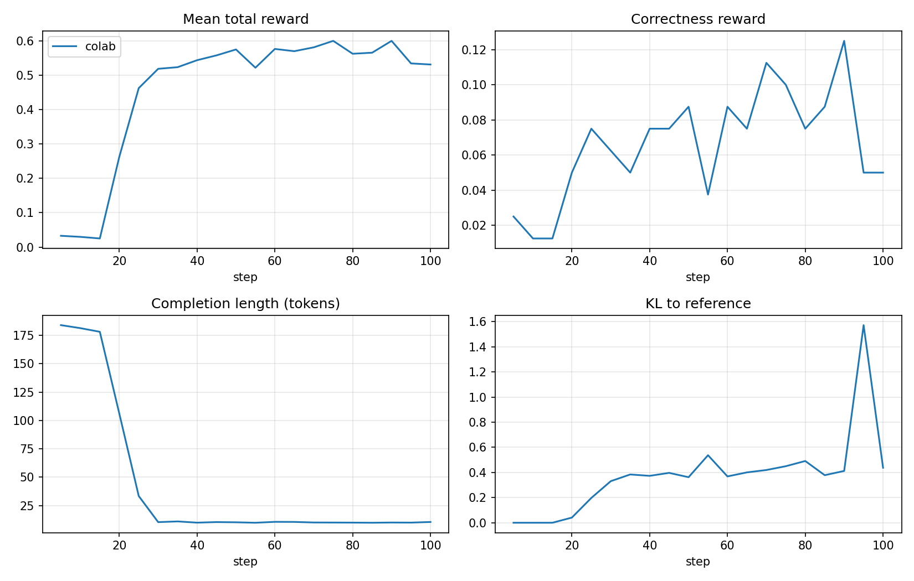

# GRPO on GSM8K with verifiable rewards


Reinforcement-learning post-training of a small instruction model
(Qwen2.5-0.5B-Instruct, swappable for Falcon3-1B or similar) on grade-school
math with **GRPO** and **rule-based, verifiable rewards**: no reward model,
only checks of the final number and the output format.

The goal is to study, at small scale, the effect of three design choices on
accuracy and training dynamics:

1. the **KL penalty** β to the reference model,
2. the **group size** G used to compute advantages,
3. **reward shaping** (correctness only vs. correctness + format rewards).

## Method

For each prompt *q*, GRPO samples a group of G completions
*o₁ … o_G* from the current policy and scores them with the reward function.
The advantage of each completion is its reward normalised within the group:

$$\hat A_i = \frac{r_i - \mathrm{mean}(r_1,\dots,r_G)}{\mathrm{std}(r_1,\dots,r_G)}$$

so no value network (critic) is needed, unlike PPO. The policy is updated with a
clipped PPO-style objective on these advantages, plus a KL term
β·KL(π_θ ‖ π_ref) that keeps it close to the starting model.

### Rewards (`src/grpo_math/rewards.py`)

The model is asked to answer as `<think>…</think><answer>N</answer>`.

| reward | value | purpose |
|---|---|---|
| `correctness` | 1.0 if the number in `<answer>` equals the gold answer | the actual task |
| `strict_format` | 0.5 if the whole output matches the template | parseable outputs |
| `soft_format` | 0.125 per tag, minus a small penalty for text after `</answer>` | dense signal early in training |
| `numeric` | 0.25 if the answer is a bare number | easier verification |

Answers are compared as exact fractions, so `7`, `7.0`, `14/2` and `$7`
all match. Rewards are weighted and summed (weights in the config).

## Project layout

```
configs/base.yaml        hyper-parameters of the baseline run
src/grpo_math/
  rewards.py             verifiable reward functions
  data.py                GSM8K loading + chat prompt
  train.py               GRPOTrainer setup (TRL, optional LoRA)
  evaluate.py            greedy evaluation, accuracy / format metrics
  config.py              YAML + dotted CLI overrides
scripts/
  train_grpo.py          training CLI
  evaluate.py            evaluation CLI
  run_ablations.sh       full ablation sweep
  plot.py                training curves + results table
notebooks/colab_quickrun.ipynb   short run on a free T4
tests/                   unit tests + offline CPU smoke test
```

## Usage

```bash
pip install -r requirements.txt
pip install -e .

# zero-shot baseline
python scripts/evaluate.py --model Qwen/Qwen2.5-0.5B-Instruct --out results/zero_shot

# GRPO training (LoRA), then evaluation of the adapter
python scripts/train_grpo.py --config configs/base.yaml
python scripts/evaluate.py --model Qwen/Qwen2.5-0.5B-Instruct --adapter outputs/base --out results/base

# any config value can be overridden from the command line
python scripts/train_grpo.py --config configs/base.yaml grpo.beta=0.0 output_dir=outputs/beta_0

# full sweep + figures
bash scripts/run_ablations.sh
python scripts/plot.py --runs base beta_0 beta_0.1 g4 g16 correct_only
```

No GPU? `notebooks/colab_quickrun.ipynb` runs a shortened version on a free
Colab T4.

### Tests

```bash
pytest -q
```

The test suite runs offline on CPU. It includes an end-to-end smoke test that
trains a tiny randomly initialised Llama for two GRPO steps (with and without
LoRA), so the full training path is checked in CI without downloading a model.

## Results

### v1: a reward-hacking run (Colab T4)

First short run: 100 GRPO steps, G = 4, 500 training questions, LoRA, fp16,
`max_completion_length=200`, evaluated greedily on 200 test questions
(`configs/v1.yaml` + the Colab overrides). Raw outputs are in
[`docs/results/v1`](docs/results/v1).

| model | accuracy (tagged) | accuracy (lenient) | format rate | mean length (chars) |
|---|---|---|---|---|
| Qwen2.5-0.5B-Instruct, zero-shot | 0.0% | **32.0%** | 0.0% | 798 |
| + GRPO v1 (100 steps) | 7.5% | **7.5%** | 0.0% | 20 |

*Tagged* only counts the number inside `<answer>`; *lenient* takes the last
number of the output.



**What happened.** The total reward rises from 0.03 to about 0.55 in 30 steps
while the completion length collapses from ~180 to ~10 tokens. By the end, the
policy answers every question with a bare `<answer>N</answer>`:

```
gold 400  →  "<answer> 185 </answer>"
gold 25   →  "<answer>15</answer>"
```

The reward was **hacked**. The two answer tags (0.25 from `soft_format`) and a
bare number (0.25 from `numeric`) were worth 0.5 *without any reasoning*,
which is far easier to collect than the correctness reward: the base model
never used the tags, so correctness was almost always 0 at the start. The
strict format reward stayed at 0 for the whole run because no sample ever
contained a `<think>` block. Lenient accuracy shows the cost: the model went
from 32% to 7.5% by giving up step-by-step reasoning.

A second issue was evaluation: with 256 new tokens, ~80% of the zero-shot
answers were cut off, and the tagged metric scored the base model at 0%.
The baseline was therefore underestimated.

### v1b: the bare-number bonus alone is enough

An intermediate run (details in
[`docs/results/v1b/NOTES.md`](docs/results/v1b/NOTES.md)) used format rewards
that already required reasoning, but kept the v1 config: strict correctness
and the 0.25 bare-number bonus.

| model | accuracy (tagged) | accuracy (lenient) | format rate | mean length (chars) |
|---|---|---|---|---|
| zero-shot (400 new tokens) | 0.0% | **42.5%** | 0.0% | 911 |
| + GRPO v1b (100 steps) | 7.0% | **7.0%** | 0.0% | 20 |

The same collapse happened. Both format rewards stayed at 0 for the whole
run, so the bare-number bonus (~0.23 of the ~0.30 mean reward) **drove the
hack on its own**. A single cheap reward term is enough. The run also shows
how much evaluation settings matter for the baseline: allowing 400 instead of
256 new tokens moves the zero-shot lenient accuracy from 32% to 42.5%, since
fewer answers are cut off. (The two zero-shot evaluations also use different
random 200-question subsets.)

### v2: fixes (to be run)

- Format rewards give **nothing unless `<think>` contains real reasoning**
  (≥ 20 characters). The exact v1 outputs are now a regression test
  (`tests/test_rewards.py`).
- The bare-number bonus is off by default.
- New `lenient_correctness` reward: 1.0 for a correct tagged answer and 0.5
  for a correct untagged one, so the base model's reasoning is rewarded from
  the first step while the format is learned.
- Longer completions (300 tokens in training, 400 at evaluation) and lenient
  accuracy reported next to tagged accuracy.
- A `v1_rewards` ablation in `run_ablations.sh` reproduces the hack at full scale.

| model | accuracy (tagged) | accuracy (lenient) | format rate |
|---|---|---|---|
| zero-shot | – | – | – |
| + GRPO v2 | – | – | – |

## Notes

- `warmup_ratio` was removed from `TrainingArguments` in transformers 5, so the
  config uses `warmup_steps`.
- With β > 0 and no LoRA, TRL rebuilds the reference model from the policy's
  config path; with LoRA the reference is obtained by disabling the adapter, so
  no second model is kept in memory.
- Evaluation uses left padding: with right padding, batched generation for
  decoder-only models appends tokens after the pad tokens.

## References

- Shao et al., 2024. *DeepSeekMath: Pushing the Limits of Mathematical Reasoning in Open Language Models* (GRPO).
- DeepSeek-AI, 2025. *DeepSeek-R1: Incentivizing Reasoning Capability in LLMs via Reinforcement Learning.*
- Cobbe et al., 2021. *Training Verifiers to Solve Math Word Problems* (GSM8K).
- Hugging Face TRL, `GRPOTrainer`.
